# Feature examples

[Installation and setup](../VSCodeExtension/README.md)

## Completion

glsld completes GLSL keywords, types, variables, functions, structure members, and other symbols available at the cursor.

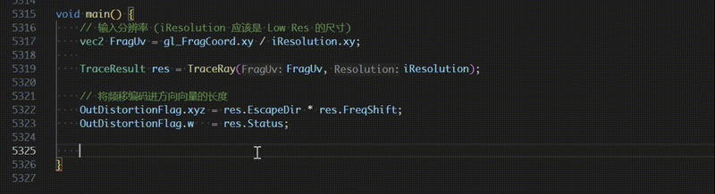

### Extension completion

Extension names and behaviors are completed inside `#extension` directives.

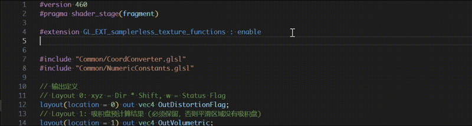

### Include completion

Include paths are completed relative to the current file, workspace, and configured system include directories.

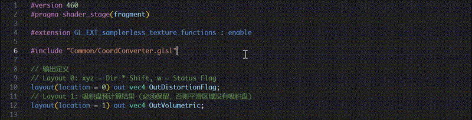

### Function overloads

When a function has multiple signatures, glsld presents the available overloads with their parameter and return types.

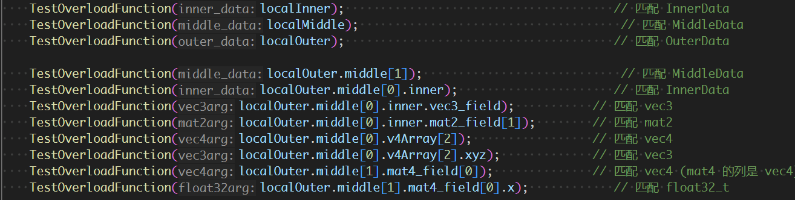

### Signature help

Signature help follows the active call, selects the matching overload, and highlights the parameter currently being entered.

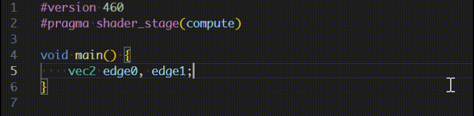

## Formatting

Format GLSL source with `clang-format`. Set `glsld.clangFormat.path` if it is not on your PATH.

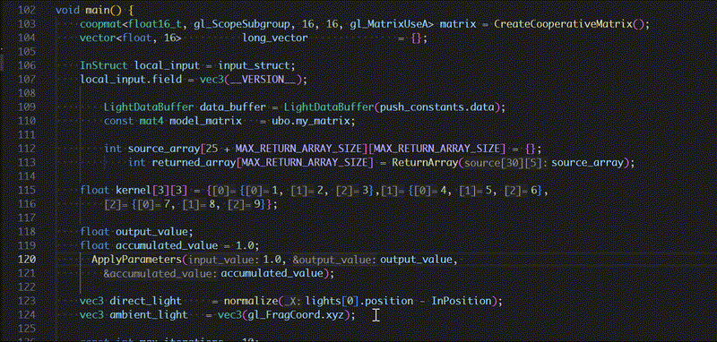

## Diagnostics

Syntax and semantic errors are reported while editing. Diagnostics can be enabled or disabled with `glsld.diagnostics.enabled`.

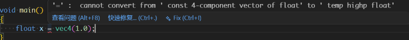

## Navigation

### Go to definition

Jump from a symbol use to its declaration or definition, including symbols declared in included files.

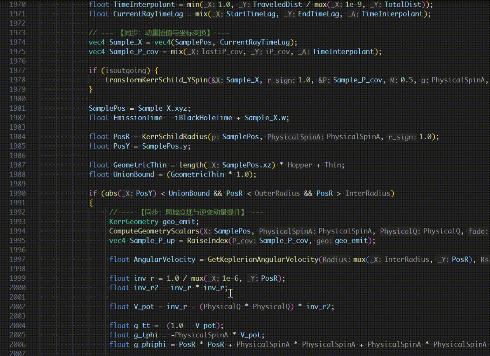

### Go to include

Open an included shader directly from its `#include` directive.

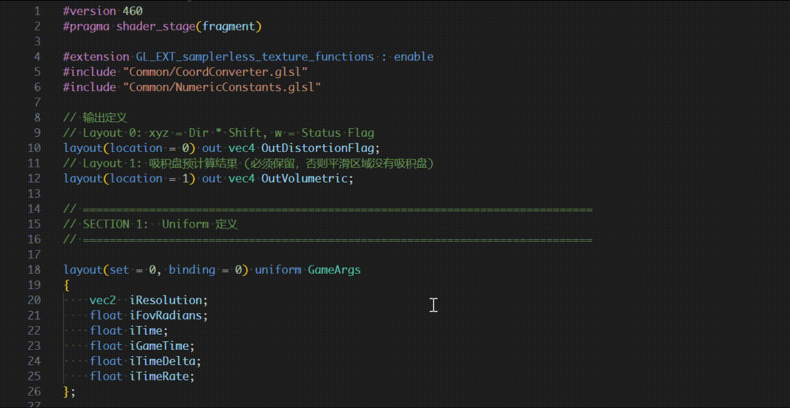

### Find references

Find symbol references across the workspace. Background indexing includes references from files that have not been opened in the editor.

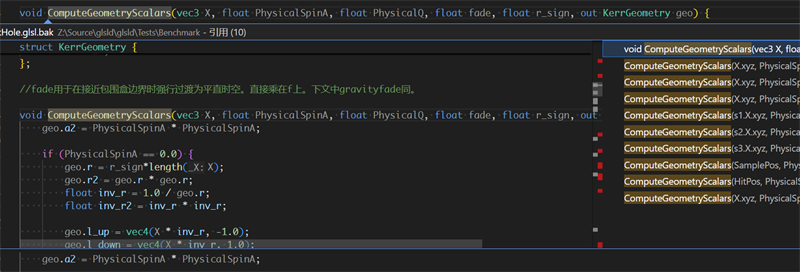

References are also tracked across include boundaries.

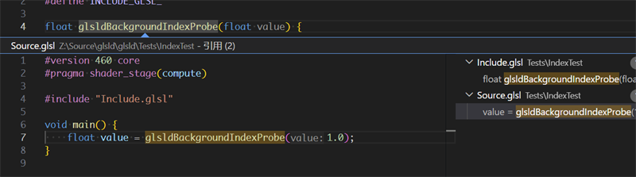

Rename symbols across the workspace.

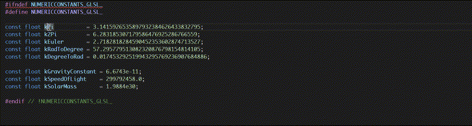

## Hover information

Hovering over a symbol displays its declaration and relevant type information.

### Variables and types

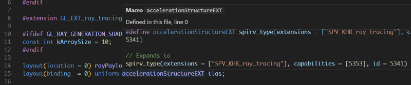
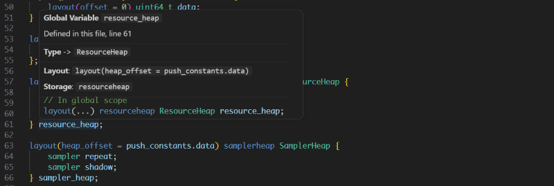

### Functions

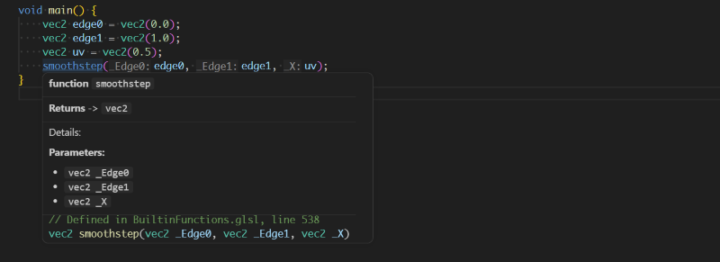

## Inlay hints

Inlay hints expose parameter names and other information that makes shader code easier to read. They are controlled by VS Code's editor inlay-hint settings.

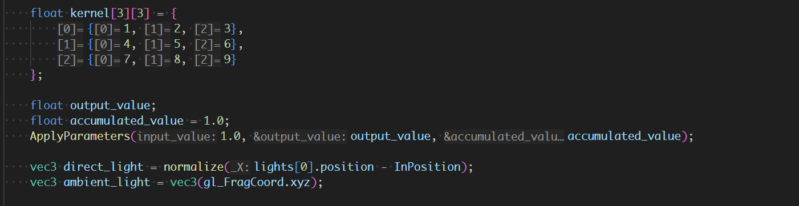

## Document symbols

The document outline lists declarations in the current shader and supports quick navigation through large files.

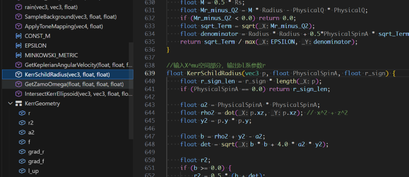

## Preprocessor macros

Manage global and per-file preprocessor macros from the glsld sidebar.

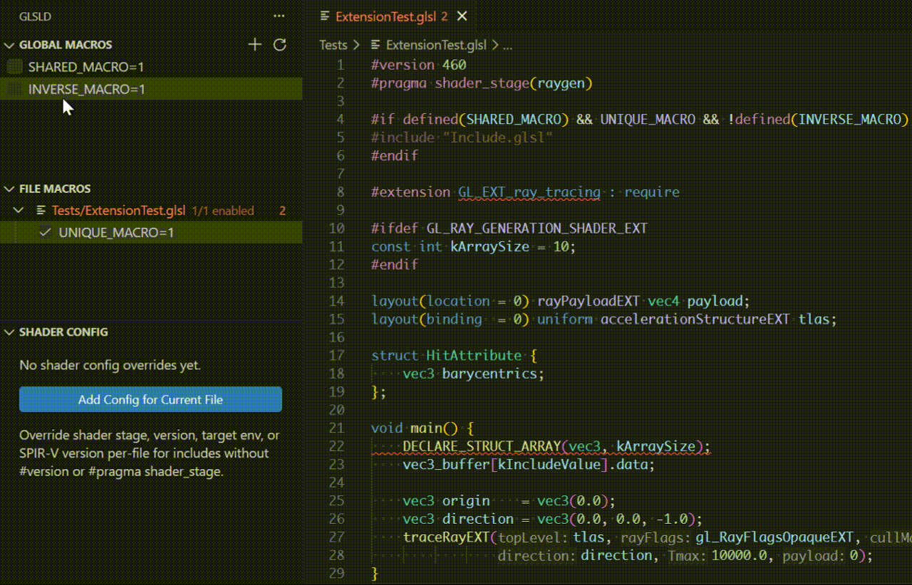

## SPIR-V compilation

Configure shader compile groups and build SPIR-V with `glslc` from the glsld sidebar.

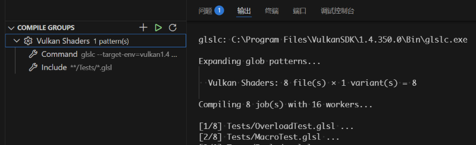
